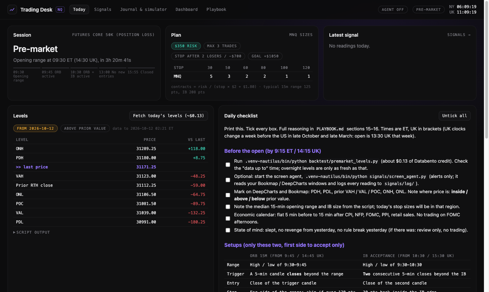
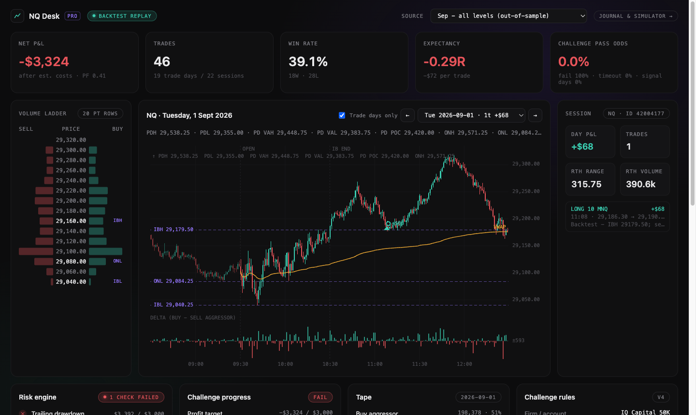

# NQ Prop Trading Toolkit

A research and execution-support toolkit for passing a futures prop-firm challenge (IQ Capital 50K) trading Nasdaq futures (NQ / MNQ) with order flow and auction market theory.

It combines quantitative research on real exchange data, a challenge simulator and trade journal, a local "Trading Desk" web app, and an AI vision agent that reads live Bookmap / DeepCharts screens and raises trade alerts.

> Educational and research project. Not financial advice. The agent only alerts; it never places orders.



## Highlights

- **Evidence-based strategy research** on 2+ years of CME NQ data (Databento), with a strict design / holdout split, parameter-family evaluation instead of picking the single best backtest, and rolling-start challenge simulations that replay real session sequences.
- **Prop-firm rule engine**: end-of-day trailing drawdown with lock, soft daily loss limit, per-position loss breaches, time windows and paid extensions. Used to compare account types and find the risk / time trade-off with the best pass rate.
- **Trading Desk app**: a local Python server and a vanilla JS single-page app with session phase and countdown, pre-market levels, position sizing, a daily checklist, the journal, simulator, dashboard and playbook in one place.
- **AI screen agent**: captures the Bookmap and DeepCharts windows (macOS Quartz), sends them to a vision model (Gemini, OpenAI-compatible or a local Ollama model) with the playbook rules, today's levels and recent context, and gets structured JSON back (signal, setup, stop, target, order-flow confirmation). Long/short calls trigger voice and desktop alerts with the contract size, and every reading is logged for later evaluation.
- **Backtest dashboard (NQ Desk Pro)**: candles with auction levels, VWAP and per-minute delta from tick data, volume ladder, trade markers, risk engine, challenge progress and pass odds.


*Dashboard replaying an out-of-sample month where the first strategy failed. Keeping losing results visible is part of the method.*

## Research findings

All results include commissions and slippage. Rules were chosen on Jul 2024 – Dec 2025 (353 sessions) and checked once on Jan – Sep 2026 (178 sessions).

| Setup | Design period | Holdout | Verdict |
|---|---|---|---|
| Absorption reversal at all levels (tick data, NautilusTrader; Jul–Aug vs Sep 2026) | −0.02R | −0.29R | Rejected: round numbers, VWAP and POC lose as entry levels |
| Value area rotation (80% rule) | family median +0.03R | −0.10R | No mechanical edge |
| Failed auction at prior high/low | −0.11R | −0.06R | No mechanical edge |
| **Initial balance acceptance breakout** | **+0.19R** (232 trades) | **+0.19R** (117 trades) | Kept: positive in both periods |
| **Opening range breakout 15m** | **+0.14R** (312 trades) | **+0.14R** (64 trades) | Kept |

Further findings:
- Parameter rankings did not carry over between periods (rank correlation −0.27), so the simple version of each setup is used and nothing is optimised.
- NQ's 1-minute noise means structure stops of 50–80 points. On a $2,000–3,000 drawdown that means 1–4 MNQ contracts.
- **Pass rate is limited by time, not drawdown.** With a small edge, 21-session challenges pass 2–21% of the time. Using the firm's $19 / 30-day extensions with a flat $350 risk raises the pass rate to about 80% in both the real rolling test and resampling, at about $100 of fees per pass.
- The Position Loss account ($39, $3,000 drawdown) beats the Daily Loss account ($49, $2,000 drawdown), with a third to half the failures, provided planned risk stays at or below $450.
- Stress tests: cutting the edge by 0.1R per trade halves the pass rate, which is why the next step is a forward test that measures whether discretionary order-flow confirmation adds edge.

The full reasoning is in [PLAYBOOK.md](PLAYBOOK.md) (sections 14–18) and [backtest/README.md](backtest/README.md).

## Architecture

```
Databento (CME GLBX.MDP3) ──> backtest/ ──────> results, dashboard/data.js ──> dashboard.html
  tbbo ticks, 1-min bars       NautilusTrader backtest, setup research,
                               rolling challenge simulations, pre-market levels
                                         │
                                         └──> signals/levels.json
                                                    │
Bookmap / DeepCharts windows ──> signals/screen_agent.py ──> vision model ──> alerts + JSONL log
                                         │
desk/server.py (127.0.0.1) ──> desk/index.html: Today · Signals · Journal & simulator · Dashboard · Playbook
                                         │
challenge.json (firm rules + plan) ──> app.html, montecarlo.py, sizer.py, research scripts
```

## Tech stack

- **Python 3.14**: NautilusTrader, Databento, pandas, NumPy, pyobjc (Quartz) and the standard library HTTP server
- **JavaScript / HTML / CSS**: no framework, canvas charts, localStorage persistence
- **AI**: vision LLMs through Gemini's OpenAI-compatible API, any OpenAI-compatible endpoint, or local Ollama (Qwen2.5-VL)
- **Data**: Databento CME Globex MDP 3.0 (tbbo, ohlcv-1m)

## Project layout

| Path | What it is |
|---|---|
| `PLAYBOOK.md`, `CHECKLIST.md` | Trading plan, research write-up and one-page daily checklist |
| `challenge.json`, `common.py` | Firm rules and trading plan, shared by every tool |
| `app.html` | Challenge simulator (Monte Carlo), trade journal with DeepCharts import, setup / confirmation analytics |
| `montecarlo.py`, `sizer.py` | Command-line simulator and position sizer |
| `backtest/` | Data download, NautilusTrader absorption strategy, auction setup research, account comparison, pass planner, pre-market levels |
| `dashboard.html` | Backtest replay dashboard (data built by `backtest/build_dashboard.py`) |
| `signals/screen_agent.py` | AI screen-reading signal agent |
| `desk/` | Trading Desk server, single-page app and macOS launcher builder |

## Getting started

```bash
python3 -m venv .venv-nautilus
.venv-nautilus/bin/pip install nautilus_trader databento pyobjc-framework-Quartz requests

# optional keys, in a git-ignored .env file (chmod 600)
echo "DATABENTO_API_KEY=..." >> .env      # market data
echo "GEMINI_API_KEY=..." >> .env         # screen agent (free tier works)

.venv-nautilus/bin/python desk/server.py --open   # Trading Desk at http://localhost:8765
```

Other entry points:

```bash
.venv-nautilus/bin/python backtest/premarket_levels.py      # today's levels (quotes the data cost first)
.venv-nautilus/bin/python backtest/research_setups.py       # auction setup research (design period)
.venv-nautilus/bin/python backtest/pass_planner.py          # pass rate vs risk and time
.venv-nautilus/bin/python signals/screen_agent.py --replay  # screen agent on Bookmap replay
python3 montecarlo.py --sweep risk                          # quick challenge simulation
```

Market data isn't included in the repository (Databento licence). The scripts download it and always print the cost before spending credit.

## Safety and design choices

- API keys live only in a git-ignored `.env`. The Trading Desk server binds to 127.0.0.1, checks the Host header, requires a custom header on write requests (no cross-site requests), and never returns stored keys.
- The screen agent is alert-only. Prop firms often restrict automated trading, and the edge is unproven until forward-tested.
- Every backtest result is reported, including the losing ones; the holdout period was evaluated once.

## Status

Research and tooling are complete. Next is a forward test of 30+ journaled trades with order-flow confirmation tags, to measure whether discretionary confirmation lifts the mechanical edge before buying the challenge.
